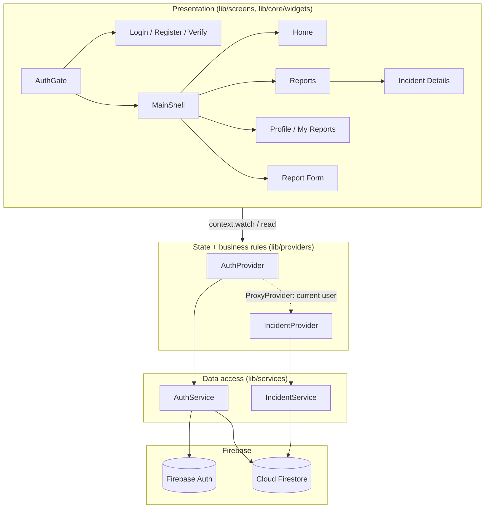
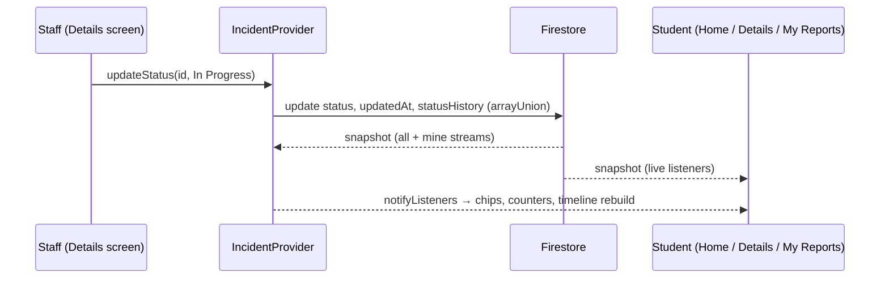
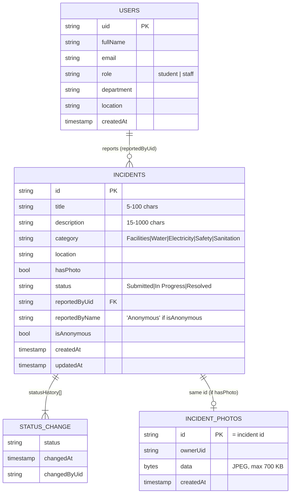

# Campus Incident Reporting App: Technical Report

> **Draft.** Items marked **[TODO]** need your own input: screenshots from
> your device and the Firebase Console, and your personal reflections. Keep
> the reflections in your own words.

**Author:** [TODO] · **Course:** [TODO] · **Date:** [TODO]

---

## 1. Problem and Goals

At ALU, campus problems such as a broken tap, a power cut in a residence or an
unsafe stairwell are usually reported informally (by word of mouth, in WhatsApp
groups or at a front desk). Reports get lost, students cannot see whether
anything is being done, and staff have no single list to work from.

This app gives the campus one channel for those reports:

- **Students** file a structured report (category, title, description,
  location, optional photo) in under a minute and track its progress.
- **Staff** see every report, filter it, and move it through a simple
  lifecycle: **Submitted → In Progress → Resolved**.
- Every status change is time-stamped, so the reporter can see *when* things
  happened, not just the current state.

### Design decisions specific to the campus

| Decision | Reason |
|----------|--------|
| Only `@alustudent.com` / `@alueducation.com` / `@aluedu.com` emails; student domains must verify before use | Keeps the app to the ALU community and blocks fake or outsider reports. |
| `@aluedu.com` sign-ups become staff without email verification | Lets staff start working on reports immediately. The trade-off is discussed in section 5. |
| Five categories (Facilities, Water, Electricity, Safety, Sanitation) | They match the departments that actually handle campus issues. "Damaged furniture" and "broken equipment" go under Facilities to keep the list short. |
| Fixed list of campus locations | Free text produced spellings staff could not group ("lib", "Library", "the library"). A dropdown keeps the data consistent. |
| Three statuses only | Matches how facilities teams work. More states (e.g. "Assigned", "On hold") would make the timeline harder for students to read. |
| Anonymous reporting | Safety and sanitation reports can be sensitive. Students should not fear being identified for raising them. |
| Edit/delete only while *Submitted* | Students can fix mistakes, but they cannot rewrite or remove a report once staff have started working on it. |

---

## 2. Architecture

The app uses a layered architecture. Each layer only talks to the layer
directly below it.



| Layer | Folder | Responsibility |
|-------|--------|----------------|
| Presentation | `screens/`, `core/widgets/` | Layout, forms, navigation. No Firebase imports. |
| State | `providers/` | Holds app state, applies business rules (who may edit/delete/update), turns errors into friendly messages. |
| Data | `services/` | The only code that calls Firebase. Can be swapped for fakes in tests. |
| Model | `models/` | Typed `Incident`, `StatusChange`, `AppUser` with `fromMap`/`toMap`. |
| Core | `core/` | Constants (categories, statuses, locations, ALU domains), theme, validators, reusable widgets. |

**Reusable widgets** (`lib/core/widgets/`): `IncidentCard`, `StatusChip`,
`FilterChipRow<T>`, `CategoryTile`, `SummaryTile`, `AppTextField`,
`PrimaryButton`, `LoadingView`, `ErrorView`, `EmptyView`. The Home, Reports
and Profile screens all share them, so a design change happens in one place.

---

## 3. State Management

**Approach: Provider with `ChangeNotifier`.**

- `AuthProvider` subscribes to `FirebaseAuth.authStateChanges()` and exposes
  `isSignedIn`, `isEmailVerified`, `currentUser`, `isStaff`, `isSubmitting` and
  `errorMessage`. `AuthGate` watches it and chooses the screen to show, so
  sign-in, sign-out and session restore after an app restart need no manual
  navigation.
- `IncidentProvider` holds two live Firestore streams (all reports, and the
  user's own reports), plus the search and filter state and all write actions.
- A `ChangeNotifierProxyProvider<AuthProvider, IncidentProvider>` passes the
  signed-in user into `IncidentProvider`. When the user changes, the streams
  are cancelled and re-opened, so data from one user never leaks into another
  user's session.
- The details screen uses a `StreamBuilder` on the single document. If staff
  change the status, a student who has the report open sees the timeline
  update immediately.

**Why Provider:**

1. It is the approach recommended in the Flutter docs for apps of this size,
   and it has less boilerplate than BLoC.
2. Firestore streams fit naturally into a `ChangeNotifier`: each snapshot
   becomes one `notifyListeners()` call.
3. Constructor-injected services make the providers testable without Firebase
   (see section 7).



---

## 4. Data Design (Firestore)



**Collections**

- `users/{uid}`: one profile per Auth account. The document id equals the
  Auth uid, so the rules can do a cheap `get()` to look up the role.
- `incidents/{incidentId}`: one document per report. `statusHistory` is
  embedded as an array because it is small (at most a few entries), it is
  always read together with the report, and staff can append to it with
  `FieldValue.arrayUnion` in the same write as `status`.

- `incident_photos/{incidentId}`: the optional photo as compressed JPEG bytes
  (a Firestore `Blob`) plus `ownerUid`.

**Why photos are in Firestore, not Cloud Storage.** New Firebase projects can
only use Cloud Storage on the paid Blaze plan. To keep the project on the free
Spark plan, photos are stored in Firestore instead:

- The image is resized to at most 1024 px and re-encoded at 70 % quality on the
  device (`image_picker`), giving roughly 100–300 KB. The app and the rules
  both reject anything over 700 KB, which stays under Firestore's 1 MiB limit
  per document.
- The photo lives in its **own collection**, not inside the incident. Loading
  the report lists therefore never downloads every photo; each photo is
  fetched only when its card or details screen is shown, then cached for the
  session.
- The report and its photo are written in a **single atomic batch**, so a
  report can never point at a photo that failed to save. Deleting a report
  removes both in one batch as well.
- The rules use `getAfter()` to check that the photo's incident (in the same
  batch) belongs to the uploader.

Trade-off: a Firestore read costs more than serving a file from a CDN, and
images are capped well below the original resolution. That is acceptable for
evidence photos of campus issues, and avoids any billing for the project.

**Design trade-offs**

- `reportedByName` is denormalised onto the incident, so lists never need a
  second read per row, and users can only read their *own* profile.
- `createdAt` / `updatedAt` use `FieldValue.serverTimestamp()`, so a device
  with a wrong clock cannot fake when a report was made.
- The "my reports" query filters only on `reportedByUid` and sorts in Dart,
  which avoids needing a composite index.

**[TODO] Screenshot:** Firebase Console → Firestore showing `users` and
`incidents`, with one incident document expanded.
**[TODO] Screenshot:** Firebase Console → Firestore → `incident_photos` (one document).

---

## 5. Authentication Flow

```mermaid
flowchart LR
    A[Open app] --> B{Signed in?}
    B -- no --> L[Login] -->|Register| R[Register<br/>ALU email only]
    R -->|@alustudent / @alueducation| V[Verification email sent<br/>users/uid created role=student]
    R -->|@aluedu.com| SP[No email sent<br/>users/uid created role=staff] --> P
    B -- yes --> C{Email verified<br/>or @aluedu.com?}
    C -- no --> VE[Verify Email screen<br/>I have verified / Resend / Use different account]
    VE -->|user.reload| C
    C -- yes --> P[Load users/uid profile] --> M[Main app<br/>Home · Reports · Profile]
    M -->|Sign out| L
    L -->|Forgot password| FP[Reset email]
```

The ALU-only rule is enforced at **three levels**:

1. **Form validators** (`validateAluEmail`) give instant inline feedback.
2. **`AuthProvider`** rejects non-ALU emails before any Firebase call.
3. **Security rules** (`hasAluEmail()` in `firestore.rules`)
   check `request.auth.token.email`. Even a user who
   bypasses the app and calls Firebase directly cannot read or write data.

**Staff domain.** Accounts on `@aluedu.com` are created with the `staff` role
and skip email verification, so staff can start triaging immediately. The
same exception is in the rules: `isStaffDomain()` lets those accounts pass
`isVerified()`, and it is the only way a profile may be created with
`role: 'staff'`. Student domains can only ever create `student` profiles.

*Trade-off:* without verification, Firebase cannot confirm that the person
actually owns the `@aluedu.com` address they typed. Anyone who registers with
an unused `@aluedu.com` address gets staff rights. This was accepted to keep
staff onboarding simple. Stronger alternatives are to require verification
for staff too, or to promote staff manually (role set by an administrator).

**[TODO] Screenshot:** Firebase Console → Authentication → Users, showing
verified ALU accounts.

---

## 6. Security and Role-Based Access Control

| Action | Student | Staff | Enforced in |
|--------|:------:|:-----:|-------------|
| Read reports | ✅ (verified ALU) | ✅ | `firestore.rules` `allow read` |
| Create report | ✅ as themselves, status must be *Submitted*, content validated | ✅ | `allow create` + `hasValidContent()` |
| Edit own report content | ✅ only while *Submitted*, only content fields | n/a | owner `allow update` |
| Change status | ❌ | ✅ only `status`, `updatedAt`, `statusHistory` | staff `allow update` |
| Delete report | ✅ own, only while *Submitted* | ❌ | `allow delete` |
| Read profile | own only | own only | `users/{uid}` |
| Change own role | ❌ (student-domain accounts are created as `student`, role is immutable) | `staff` only via an `@aluedu.com` sign-up or an admin in the Console | `users` create/update rules |
| Add photo | ✅ only with their own new report, ≤ 700 KB, cannot be changed later | ✅ | `incident_photos` rules |

The app hides controls that the user's role does not allow (e.g. no status
dropdown for students, and no edit/delete once a report is *In Progress*).
The **rules are the real enforcement**. The UI checks are only for usability.

### Privacy and misuse

- **Anonymous reports.** The reporter's name is replaced with "Anonymous"
  *before* it is stored, so nobody, staff included, can read it from the
  database. The uid is still stored so that ownership rules work and an
  administrator can trace abuse if necessary.
- **Minimal profile exposure.** Users can only read their own `users`
  document. Other users' emails are never sent to the client.
- **Spam and junk prevention.** Verified ALU accounts only. Server-side length
  limits and a fixed category list. Server timestamps. Photos are limited to
  compressed images of 700 KB or less.
- **Tamper-resistance.** Students cannot change a report's status, change their
  own role, or rewrite a report after staff have started on it.

---

## 7. Testing

`flutter test` runs **102 automated tests**. All pass, and `flutter analyze`
reports no issues.

| File | Tests | Covers |
|------|------:|--------|
| `models_test.dart` | 16 | `fromMap`/`toMap` round trips, defaults for missing fields, enum parsing |
| `incident_provider_test.dart` | 21 | live streams, search/filters, counters, submit with/without photo, oversized photo rejected, photo caching, staff-only status update, edit/delete ownership rules, anonymous reports |
| `auth_test.dart` | 11 | ALU and staff domain checks, validators, Firebase error → friendly message, provider rejects non-ALU email |
| `report_form_test.dart` | 9 | camera or gallery choice, required fields, min lengths, submit + success, data kept on failure, double-tap protection |
| `report_edit_test.dart` | 1 | edit mode pre-fills and saves |
| `reports_screen_test.dart` | 9 | search and filter chips, empty/loading/error states |
| `incident_details_test.dart` | 6 | timeline, staff-only controls, delete flow |
| `home_screen_test.dart` | 7 | summary counters, navigation wiring |
| `profile_screen_test.dart` | 5 | my reports, sign-out confirmation |
| `layout_test.dart`, `widget_test.dart` | 9 | no overflow at 360 / 390 / 1200 px, shared widgets |

**Approach.** Services are injected into providers, so tests use
`FakeIncidentService` and `FakeAuthService`
(`test/helpers/fakes.dart`) driven by `StreamController`s. This tests real
provider logic and real widgets without a network.

**Security rules tests.** `rules_test/rules.test.mjs` runs **48 checks** of
`firestore.rules` against the Firestore emulator with
`@firebase/rules-unit-testing`, all passing. They cover the ALU domain check
(including a lookalike `aluedu.com.evil.com`), verification, students being
unable to make themselves staff, report validation, owner-only edit and
delete while *Submitted*, staff-only status changes, the 700 KB photo limit
and atomic report + photo batches. Run with `cd rules_test && npm test`.

**End-to-end testing.** The production web build (built with
`--dart-define=USE_EMULATORS=true`) was run against the Auth and Firestore
emulators and driven through the real UI in Chrome with a staff and two
student accounts. All of these passed: Gmail rejected; `@aluedu.com` staff
straight in; student verification gate; empty-form validation; report with
photo; anonymous report; search and filters; student edit and delete; staff
status change shown live on the student's screen in about 1.2 s; wrong
password; forgot password; sign-out, sign-in and session kept after reload.

This testing found one real bug: after verifying, a student was let in but
every Firestore read was refused. `user.reload()` does not refresh the cached
ID token, which still said `email_verified: false`. The app now forces a token
refresh when the account is verified but the token is not.

---

## 8. UI/UX Decisions

[TODO] Add screenshots: Login, Register, Verify Email, Home, Report Form,
Reports (with a filter applied), Incident Details (student and staff view),
My Reports.

- **Bottom navigation with a raised "+" button.** Reporting is the main action,
  so it is one tap from every tab.
- **Status colours** are consistent everywhere (chips, counters, timeline).
- **Feedback on every async action:** button spinners, loading views,
  friendly error banners or snackbars with a *Retry*, and empty states with
  guidance.
- **Forms keep their data on failure**, so a lost connection doesn't make the
  user retype a report.
- **Confirmation dialogs** before destructive actions (delete, sign out).
- **Responsive shell** keeps a phone-width layout centred on web and tablets.

---

## 9. Challenges, Limitations and Lessons Learned

### Challenges
[TODO] In your own words. Possible points: getting the Firestore rules
right for two roles; fitting photos into the free plan (compressed bytes in
Firestore, read as bytes so it works on web and mobile); keeping several screens in sync
(solved with ProxyProvider + streams).

### Known limitations
- Staff accounts (`@aluedu.com`) are not email-verified, so ownership of the
  address is not proven (see section 5). There is no admin screen to review
  or revoke staff accounts; that is done in the Firebase Console.
- No push notifications when a status changes. Users see it next time they
  open the app (live while it is open).
- A report has only one photo, and the photo can't be changed after
  submission.
- All reports are loaded in one stream. At a much larger scale this would need
  pagination or per-campus queries.
- The rules tests run locally; they are not yet in a CI pipeline.

### Lessons learned
[TODO] In your own words.

---

## 10. References (APA 7th)

Flutter. (n.d.). *Build a form with validation*. Retrieved November 10, 2026,
from https://docs.flutter.dev/cookbook/forms/validation

Flutter. (n.d.). *Simple app state management*. Retrieved November 10, 2026,
from https://docs.flutter.dev/data-and-backend/state-mgmt/simple

Flutter. (n.d.). *Testing Flutter apps*. Retrieved November 10, 2026, from
https://docs.flutter.dev/testing/overview

Google. (n.d.). *Firebase Authentication*. Firebase. Retrieved November 10,
2026, from https://firebase.google.com/docs/auth

Google. (n.d.). *Get started with Cloud Firestore Security Rules*. Firebase.
Retrieved November 10, 2026, from
https://firebase.google.com/docs/firestore/security/get-started

Google. (n.d.). *Usage and limits* (Cloud Firestore). Firebase. Retrieved November 10,
2026, from https://firebase.google.com/docs/firestore/quotas

Rousselet, R. (n.d.). *provider* [Computer software]. pub.dev. Retrieved
November 10, 2026, from https://pub.dev/packages/provider
